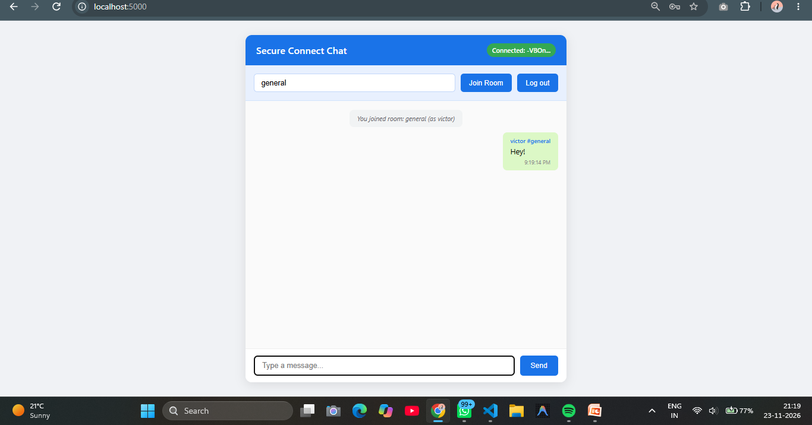
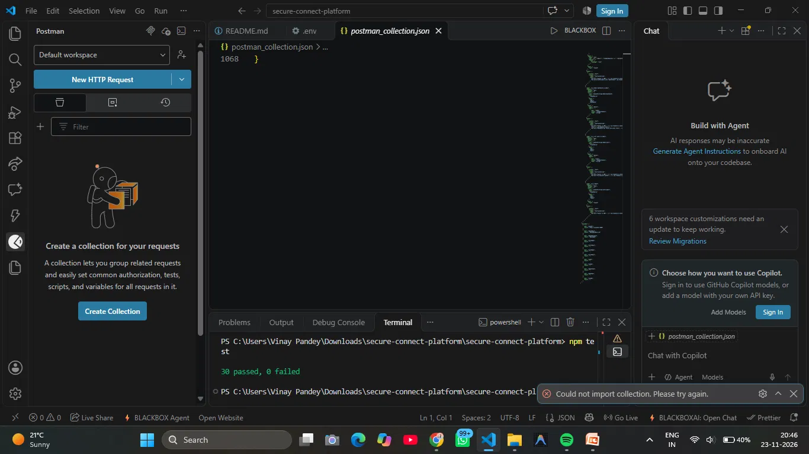

# Web Dev III - Lab 4: Secure Connect and Communication Platform

A secure backend built with **Node.js, Express, MongoDB (Mongoose), JWT, bcrypt, dotenv, Socket.IO and EventEmitter**.
No authentication boilerplate or starter kit is used.

## Features
| Requirement | Where | How it works |
|---|---|---|
| Signup and Login | `controllers/authController.js` | Passwords hashed with **bcrypt** (10 rounds); hashes are never returned |
| JWT Authentication | `utils/token.js`, `middleware/authMiddleware.js` | Login returns a signed JWT (also set as an httpOnly cookie). Accepted as `Authorization: Bearer <token>` or the `token` cookie |
| Protected Routes + RBAC | `middleware/authMiddleware.js`, `roleMiddleware.js` | No token -> 403, bad/expired token -> 401, wrong role -> 403. Admin is created from `.env`, never through signup |
| Secure Notes API | `controllers/noteController.js` | Full CRUD; every note belongs to its owner, other users get 403 |
| Real-Time Chat | `socket/chat.js` | Socket.IO; JWT required to connect, rooms, sender name comes from the token |
| Event-Driven Features | `events/eventEmitter.js` | EventEmitter events for signup, login, note create/delete and chat; listeners log them and keep counters shown on the admin dashboard |
| Environment variables | `.env` / `dotenv` | No secrets hard-coded |

## Setup
```bash
npm install
cp .env.example .env        # Windows: copy .env.example .env
# edit .env and set JWT_SECRET
# make sure MongoDB is running (local service or Atlas URI in MONGO_URI)
npm start                   # http://localhost:5000
```
Expected start-up output:
```
[MongoDB] Connected to 127.0.0.1/secure_connect_db
[Seed] Admin account created: admin@example.com
[server] listening on http://localhost:5000
```
- Automatic tests (server must be running): `npm test`
- Postman: import `postman_collection.json`, or create the requests from the API table below.

## API
| Method | Route | Access | Success |
|---|---|---|---|
| POST | `/api/auth/signup` | public | `201 {message, id, username, email}` |
| POST | `/api/auth/login` | public | `200 {message, token}` (+ cookie) |
| POST | `/api/auth/logout` | public | `200` |
| GET | `/api/auth/profile` | JWT | `200` user (no password) |
| POST / GET | `/api/notes` | JWT | `201` note / `200` array of my notes |
| GET / PUT / DELETE | `/api/notes/:id` | JWT + owner | `200` |
| GET | `/api/admin/dashboard` | JWT + admin | `200` counts + event counters |
| GET | `/api/admin/users` | JWT + admin | `200` all users |

Errors always look like `{ "message": "..." }`: 400 bad input, 401 invalid token or login, 403 no token / wrong role / not your note, 404 not found, 409 duplicate user.

## Real-Time Chat (Socket.IO)
Open `http://localhost:5000` in two tabs, log in as two different users and chat.

| Event | Direction | Payload |
|---|---|---|
| `join_room` | client -> server | `{ room }` |
| `send_message` | client -> server | `{ room, message }` |
| `receive_message` | server -> room | `{ sender, message, room, timestamp }` |
| `joined_room_ack`, `error_message` | server -> client | status / error text |

Everyone joins `general` automatically. Console output:
```
User connected: sK92_xT31Qp
sK92_xT31Qp joined room general
[general] Aditi: Hey team, backend is ready
```

## EventEmitter Events
`user_registered`, `user_logged_in`, `note_created`, `note_deleted`, `chat_connected`, `chat_message`
```
[EVENT: USER_REGISTERED] [2026-11-23T08:28:15.673Z] victor <victor@example.com> (role: user)
```

## Output Screenshots

### Signup and Login


### Protected Route Without Token (403)


### Secure Notes API


### Real-Time Chat



### Automated Tests


## Folder Structure
```
config/        db.js, seedAdmin.js
controllers/   authController.js, noteController.js, adminController.js
middleware/    authMiddleware.js, roleMiddleware.js, errorMiddleware.js
models/        User.js, Note.js
routes/        authRoutes.js, noteRoutes.js, adminRoutes.js
events/        eventEmitter.js
socket/        chat.js
utils/         token.js, cookies.js
public/        index.html (chat client)
screenshots/   output screenshots used in this README
test/          test-scenarios.js
app.js         Express app
server.js      HTTP + Socket.IO + DB start-up
```